# AK Screen 2.4.0 · revisión de biblioteca, gráficos y widgets

[Descargar](https://github.com/Edgajuman/AKScreen-Downloads/releases/tag/ak-v2.4.0) · [README](../README.md)

Esta entrega reemplaza los instaladores de **la misma versión 2.4.0**. No crea
una versión 2.5 ni publica un anuncio automático en el editor. Descarga el
instalador actualizado si utilizaste la primera entrega de 2.4.0.

## Gráficos de datos editables

**Herramientas → Gráficos interactivos** ofrece seis tipos: barras verticales,
barras horizontales, líneas, sectores, anillos y cronologías. Permite editar
valores y etiquetas, importar CSV y configurar título, subtítulo, fuente, tamaño,
colores, fondo, contorno, radio, espaciado y duración. La entrada puede animarse
con escalonamiento o permanecer estática.

Al insertarlo se crea un clip con capas de formas y textos, controles editables
y fotogramas clave. Puedes actualizar el gráfico seleccionado y deshacer.
La exportación conserva su imagen y animación; no convierte el video en una
aplicación interactiva para el espectador.

## Biblioteca pública y aportes

**Herramientas → Biblioteca comunitaria** consulta recursos aprobados. Admite
imágenes, GIF, video, audio, LUT, filtros, efectos, transiciones, animaciones,
Essential Graphics, Essential Sound y plantillas de gráficos `.akchart`.

Puedes descargar un archivo o toda una colección. La instalación verifica su
tamaño y SHA-256 y conserva los archivos localmente. **Effects → Biblioteca ·
Descargas** los organiza por colección; medios y títulos se insertan en el
proyecto y los presets se aplican a la selección.

**Preparar aporte** permite preparar la colección con su licencia y previews.
Publicar requiere autorizar tu cuenta mediante la GitHub App, instalarla en
el fork elegido y enviar un pull request. Solo los aportes aceptados aparecen
en el catálogo. No se incluye un token compartido.

La colección de **edgajuman** incluye 20 recursos CC0 en cuatro paquetes:
Motion Essentials (7), Data Stories (6), Sound & Surfaces (6) y Loop Studies (1).

## Efectos y navegación

El panel Effects permite alternar lista y galería. Las transiciones visuales
se muestran animadas al pasar el cursor y los efectos admitidos comparan el
resultado con la imagen original. Las muestras usan escenas generadas; no
pretenden representar todos los parámetros de un clip real.

El menú Herramientas tiene desplazamiento y agrupa las acciones por extensión.
Los catálogos muestran descripción, compatibilidad, controles, permisos y
versiones. Los controles flotantes y paneles de widgets comparten los mismos
datos de extensión.

## Extensiones, Chat AI y temas

Se incluyen Notes, Tutorial Checklist, Motion Titles, Camera Tools, Finish Tools,
Chat AI, Audio Workbench, Color Workbench, Motion Kit, Chart Atelier, Brand Titles
y Delivery Checklist. WASM Lab ofrece además un ejemplo del SDK. Las versiones
corregidas pertenecen a **edgajuman** y conservan sus identificadores y datos.

Chat AI utiliza mensajes diferenciados, entrada multilínea, historial local y
estado de respuesta. Ofrece OpenAI, OpenRouter, Gemini, Claude y Grok con claves
propias en el almacén de credenciales del sistema. El contexto del proyecto y
la imagen son opcionales. El asistente no ejecuta acciones en el editor.

Cada widget puede declararse para panel, ventana flotante o ambos. Sus estilos
nativos están acotados a la extensión y pueden heredar los colores del tema.
Actualizar conserva datos; desinstalar ofrece borrar datos y claves por separado.

**Studio Gallery** muestra el sistema de temas: 47 colores, 11 medidas, layout,
24 SVG, fuente local con licencia, fondo WebP y carga GIF. El CSS nativo permite
seleccionar lista o galería, columnas, aspecto de tarjetas y reproducción al
pasar el cursor, además de los tokens y controles documentados. No admite
JavaScript ni CSS web arbitrario.

**Theme Studio** conserva recursos en el navegador, previsualiza fondos con
superficies translúcidas y una pantalla de inicio que representa la app nativa.
Su catálogo permite explorar temas antiguos y crear remakes para la versión
actual, conservando archivos, licencias y créditos. El ZIP exportado está listo
para revisión mediante pull request. La representación web debe comprobarse
después en la aplicación.

## Páginas disponibles

- [Temas](https://edgajuman.github.io/AK-Screen-Themes/)
- [Theme Studio](https://edgajuman.github.io/AK-Screen-Themes/theme-studio.html)
- [Extensiones](https://edgajuman.github.io/AK-Screen-Extensions/)
- [Biblioteca](https://edgajuman.github.io/AKScreen-Assets/)
- [SDK](https://github.com/Edgajuman/AK-Screen-Extensions/tree/main/sdk)
- [GitHub App para publicar](https://github.com/apps/ak-screen-asset-publisher)
- [Panel de anuncios del administrador](https://edgajuman.github.io/AKScreen-Downloads/panel/)

## Capturas reales de validación en Windows

Estas 16 capturas corresponden a la app instalada y a contenido de demostración
generado por ella. Se tomaron antes de corregir el nombre de autor a edgajuman:
algunas imágenes aún muestran el nombre anterior. El chat mostrado en el catálogo
es una **vista previa con mensajes de ejemplo**, no una respuesta de API verificada.

### Editor y galería

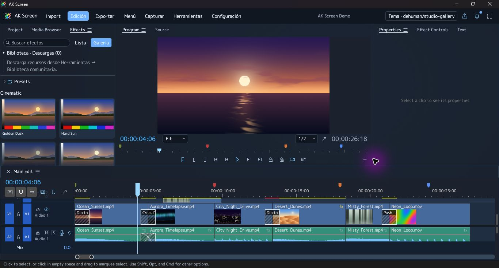

### Gráficos: barras, apariencia, líneas y anillos

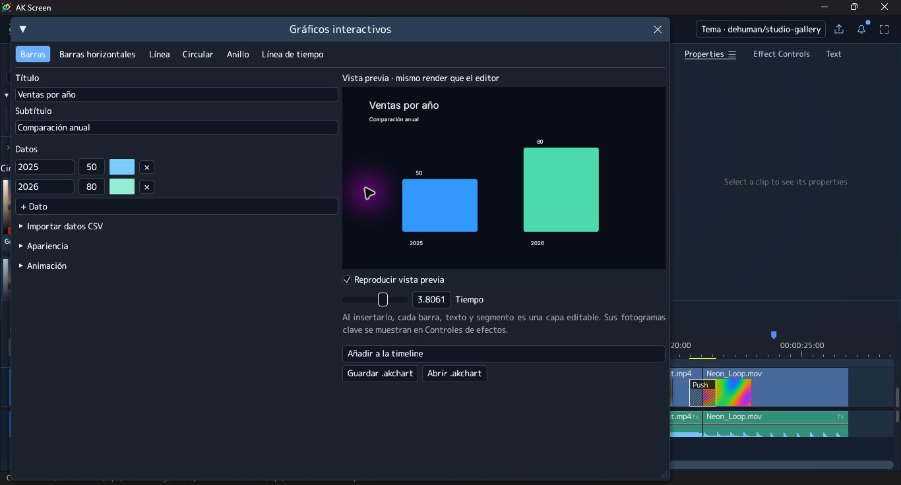
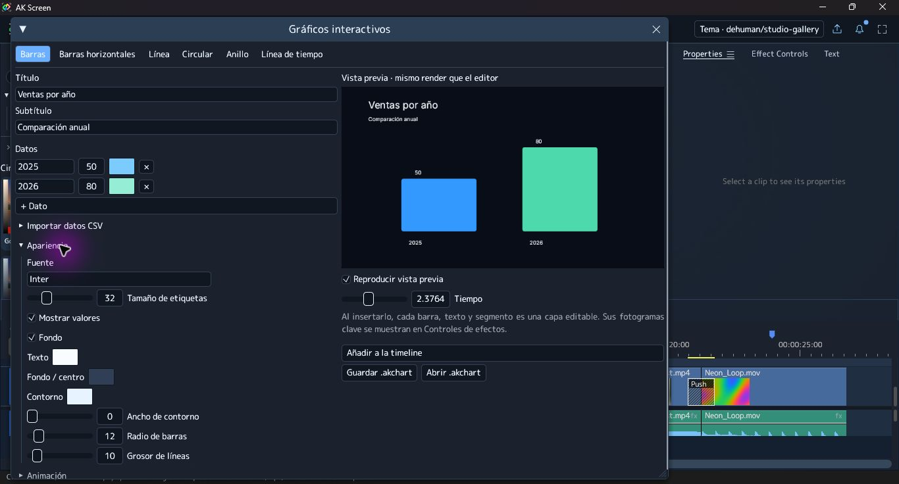
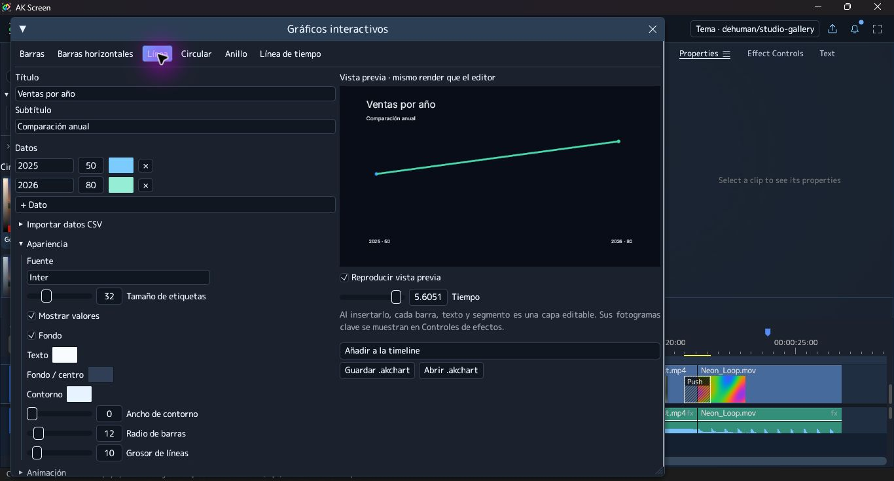
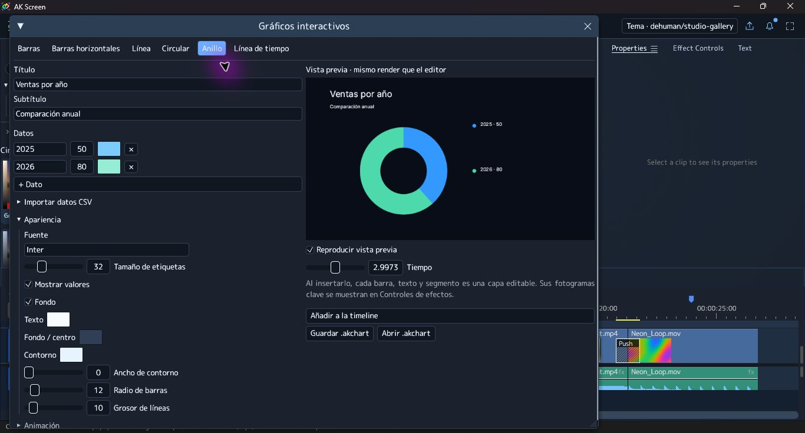
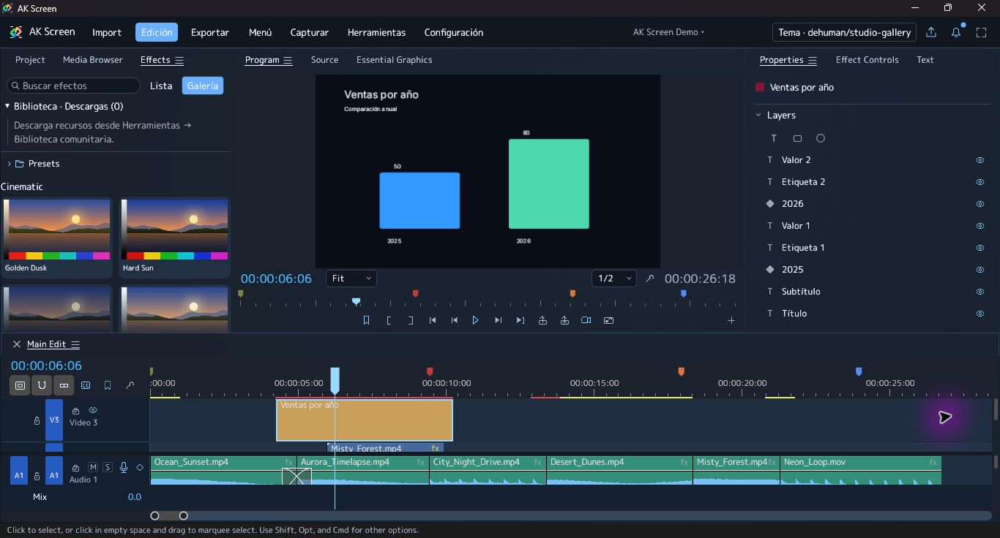

### Biblioteca: catálogo, instalación y uso

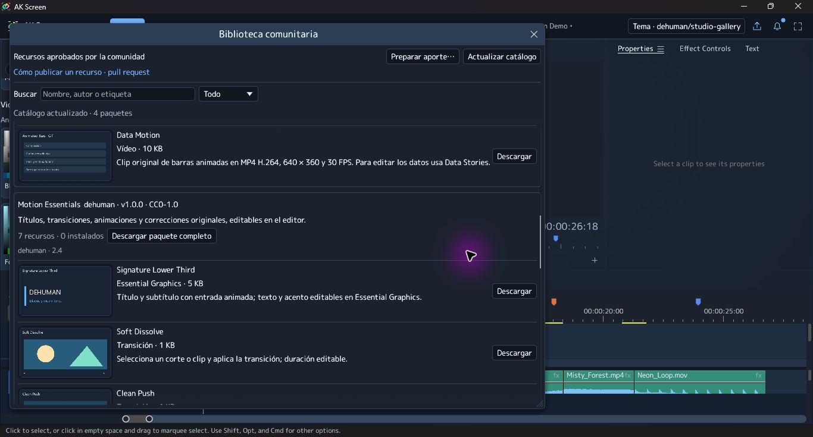
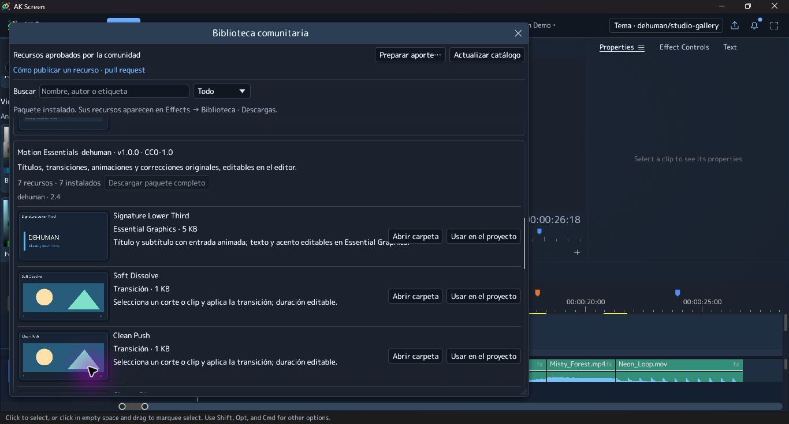
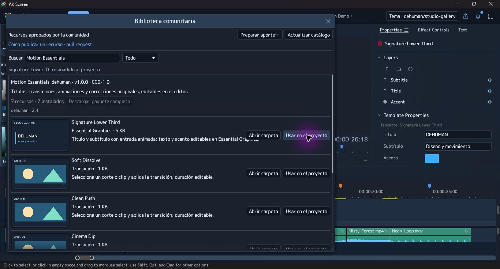
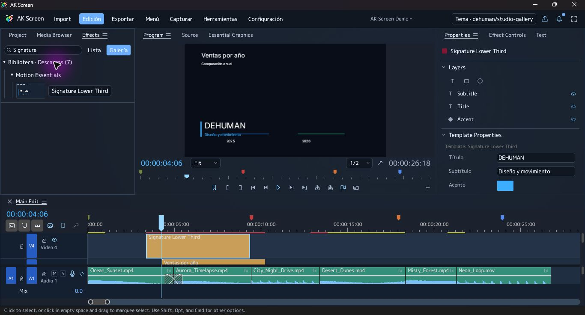

### Extensiones, widgets y menús

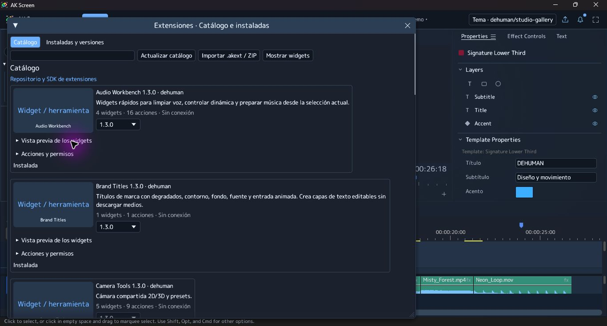
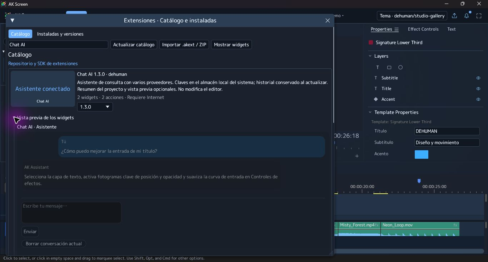
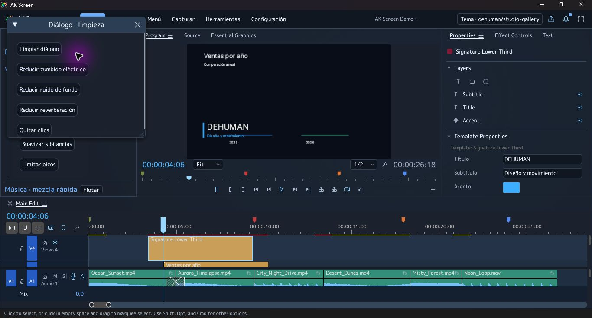
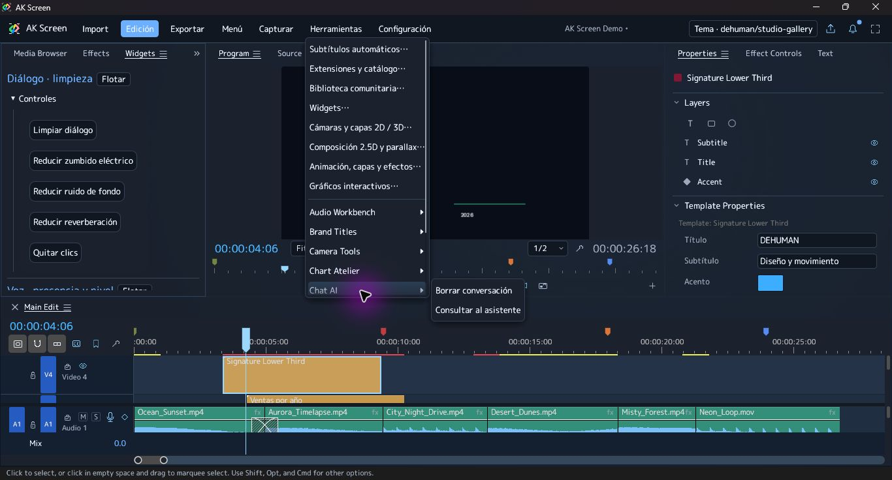
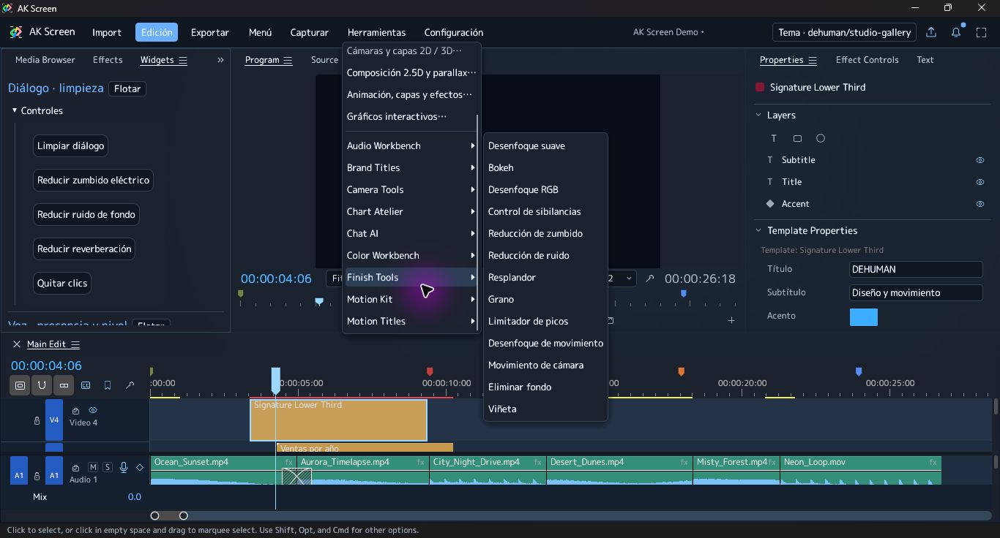

### Temas integrados

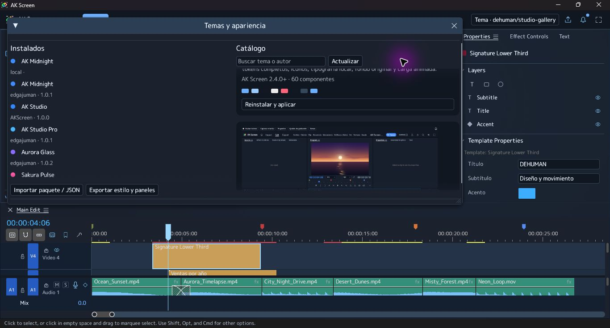

## Validación y límites

La matriz de GitHub Actions valida Windows x64, Linux x64, macOS Intel y Apple
Silicon. Las capturas y comprobaciones manuales corresponden a **Windows**.
Se comprobó una descarga completa de siete recursos, la inserción de un título
descargado, el gráfico en Program y timeline, ventanas flotantes y scroll.
El diagnóstico de captura verificó pausa, video y pista de audio; los FPS
efectivos dependen del hardware. Las claves de proveedores no se usaron para
realizar llamadas de pago durante estas pruebas.

AK Screen también mantiene las herramientas de captura de tutoriales, cursor
simulado, zoom al arrastrar, texto con atajo, captura de interfaces, cámara y
capas 2D/3D, motion, guardado local, atajos, subtítulos bajo demanda y campana
de novedades descritas en el [README](../README.md). No se presentan como
funciones nuevas exclusivas de esta revisión.
